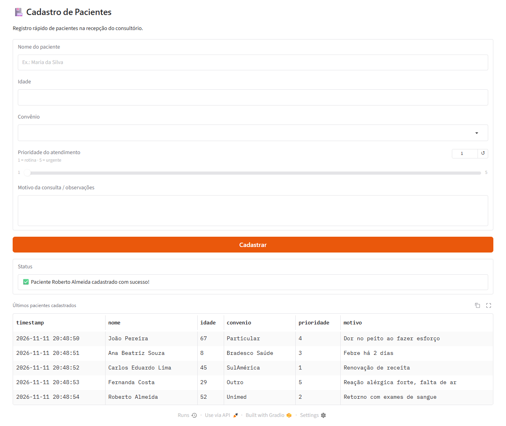
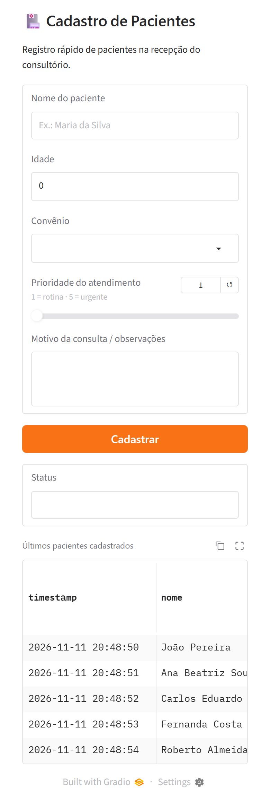
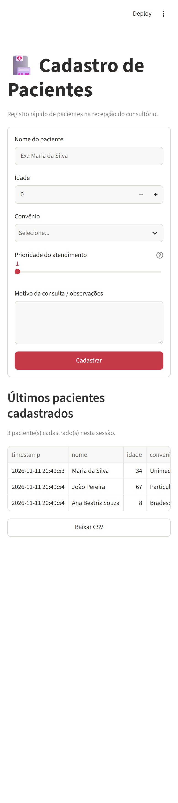

# Cadastro de Pacientes — Gradio x Streamlit

Atividade Prática da Aula 1 de **Aplicações em Data Science** (prof. Francisco Fambrini).

A mesma aplicação de coleta de dados — o cadastro de pacientes usado pela recepção de um consultório médico — foi feita duas vezes, uma com cada biblioteca, para comparar na prática as vantagens, limitações e formas de publicação de cada uma.

| Pasta | Biblioteca | Onde roda | Onde os dados ficam |
|---|---|---|---|
| [`gradio_app/`](gradio_app/) | Gradio (`gr.Blocks`) | Local | [`gradio_app/pacientes.csv`](gradio_app/pacientes.csv) |
| [`streamlit_app/`](streamlit_app/) | Streamlit (`st.form`) | Streamlit Community Cloud | `st.session_state` + `pacientes.csv` efêmero + botão **Baixar CSV** |

**App publicado (Streamlit Community Cloud):** _link a preencher após o deploy_

## Formulário

| Campo | Gradio | Streamlit |
|---|---|---|
| Nome do paciente | `gr.Textbox` | `st.text_input` |
| Idade (0–120) | `gr.Number(precision=0)` | `st.number_input` |
| Convênio (Particular, Unimed, Bradesco Saúde, SulAmérica, Outro) | `gr.Dropdown` | `st.selectbox` |
| Prioridade do atendimento (1 a 5, 5 = urgente) | `gr.Slider` | `st.slider` |
| Motivo da consulta / observações | `gr.Textbox(lines=3)` | `st.text_area` |

Cada envio gera uma linha com as colunas `timestamp, nome, idade, convenio, prioridade, motivo`. O horário usa o fuso `America/Sao_Paulo`, porque os servidores do Streamlit Cloud rodam em UTC.

Melhorias em relação aos esqueletos fornecidos:

- validação de campos obrigatórios (nome e convênio) com mensagem de erro;
- formulário limpo após cada cadastro (Gradio) e tabela recarregada ao abrir a página;
- versão Streamlit também grava `pacientes.csv`, com a mesma lógica da versão Gradio, além de manter a sessão em `st.session_state`;
- layout em coluna única nas duas versões, testado em largura de celular (390 px).

## Prints

| Gradio — local (desktop) | Gradio — local (celular) | Streamlit — celular |
|---|---|---|
|  |  |  |

## Como executar localmente

```bash
python -m venv .venv
.venv\Scripts\activate            # Windows  (Linux/macOS: source .venv/bin/activate)
pip install -r requirements.txt

python gradio_app/app.py           # Gradio    -> http://127.0.0.1:7860
streamlit run streamlit_app/app.py # Streamlit -> http://localhost:8501
```

## Deploy no Streamlit Community Cloud

1. Acesse [share.streamlit.io](https://share.streamlit.io) e entre com a conta do GitHub.
2. Clique em **Create app → Deploy a public app from GitHub**.
3. Preencha: repositório `GabrielFePL/gradio-e-streamlit`, branch `main`, arquivo `streamlit_app/app.py`.
4. Escolha um subdomínio (ex.: `cadastro-pacientes`) e clique em **Deploy**.
5. Teste pelo link `*.streamlit.app`, inclusive no celular.

O Streamlit Cloud instala o [`requirements.txt`](requirements.txt) da raiz do repositório.

## Comparativo: Gradio x Streamlit

| Aspecto | Gradio | Streamlit |
|---|---|---|
| Modelo de programação | Orientado a eventos: componentes + `botao.click(fn, entradas, saídas)` | Script reexecutado de cima a baixo a cada interação |
| Agrupar o formulário | `gr.Blocks` organiza o layout; o envio é o evento do botão | `st.form` segura as entradas até o `form_submit_button` |
| Estado | Os dados voltam como saída da função; para estado de sessão existe `gr.State` | `st.session_state` acumula dados entre reexecuções |
| Persistência na nuvem | Na máquina local o CSV é permanente | Disco efêmero no Community Cloud → precisa de `st.download_button` (ou banco externo) |
| Layout no celular | Responsivo por padrão; tabelas largas ganham rolagem horizontal | Responsivo por padrão; `layout="centered"` funciona bem em telas pequenas |
| Publicação | `share=True` gera link temporário (72 h); hospedagem fixa no Hugging Face Spaces | Streamlit Community Cloud: conecta o GitHub e redeploya a cada push |
| Ponto forte | Demos de modelos de ML (entradas → função → saídas) e API automática | Apps de dados e dashboards com fluxo de script simples |
| Limitação observada | Atualizar vários componentes exige devolver todos como saída | A reexecução do script inteiro pede cuidado com estado e custo de processamento |

## Estrutura

```
.
├── gradio_app/
│   ├── app.py
│   └── pacientes.csv        # CSV de exemplo gerado nos testes
├── streamlit_app/
│   └── app.py
├── docs/prints/             # capturas de tela
├── requirements.txt         # gradio, streamlit, pandas, tzdata
└── README.md
```
